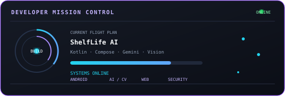
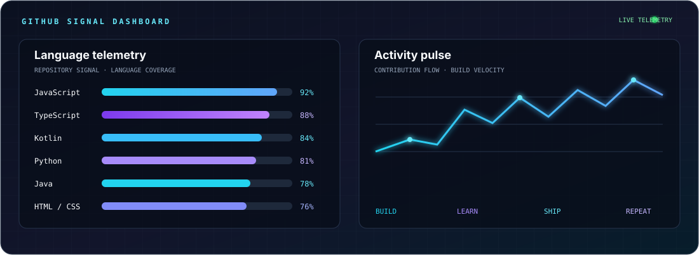
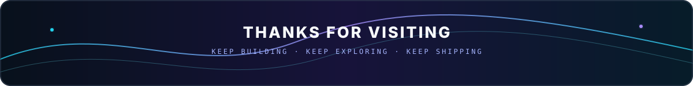

<div align="center">



</div>

<!-- BADGES ROW -->
<p align="center">
  
  &nbsp;
  
</p>

<!-- DIVIDER -->


---

## 🌌 &nbsp;About Me

<table>
<tr>
<td width="55%" valign="top">

```yaml
╔══════════════════════════════════════╗
  PROFILE: GANESH B C
══════════════════════════════════════
  location    : Chennai, India 🇮🇳
  degree      : B.E. Computer Science
  institution : Saveetha Engineering
  year        : 2nd Year (2025–2029)
══════════════════════════════════════
  specialties :
    ● Android Development (Kotlin + Compose)
    ● Offline-First Product Engineering
    ● Generative AI & Computer Vision
    ● Web Development (React + Vite)
    ● Cybersecurity & Cryptography
    ● 3D Modeling (Blender/Fusion 360)
══════════════════════════════════════
  currently   : Building intelligent, accessible apps
  email       : ganesh180208@gmail.com
╚══════════════════════════════════════╝
```

</td>
<td width="45%" valign="top" align="center">

<br/>


<br/>



</td>
</tr>
</table>


---

## 🛸 &nbsp;Tech Stack

<p align="center">
  &nbsp;&nbsp;&nbsp;&nbsp;&nbsp;&nbsp;&nbsp;&nbsp;&nbsp;&nbsp;&nbsp;&nbsp;&nbsp;&nbsp;&nbsp;&nbsp;&nbsp;&nbsp;
</p>
<p align="center">
  &nbsp;&nbsp;&nbsp;&nbsp;&nbsp;&nbsp;&nbsp;&nbsp;&nbsp;&nbsp;&nbsp;&nbsp;&nbsp;&nbsp;&nbsp;&nbsp;
</p>

<br/>

<div align="center">

| 📱 Android & AI | 🌐 Web | 🔐 Systems & Security | 🎨 Design & Hardware |
|:---:|:---:|:---:|:---:|
|         |         |        |         |
</div>

<p align="center">
  <b>IBM & Infrastructure</b><br/>
  &nbsp;
  &nbsp;
  &nbsp;
  
</p>

<p align="center">
  <sub>Also exploring: CameraX · Google ML Kit · Dagger Hilt · Room offline persistence · IoT development boards · cryptography · computer vision · linear algebra · machine learning</sub>
</p>


---

## 📊 &nbsp;GitHub Analytics

<div align="center">
  
</div>

> Live repository cards are refreshed by GitHub Actions; this dashboard adds a visual layer for the language and contribution signals.


---

## ✨ &nbsp;Contribution Orbit

<div align="center">
  
</div>

> A custom SVG animation for the commits, experiments, and ideas constantly moving through my GitHub universe.


---

## 🚀 &nbsp;Featured Projects

<br/>

<table width="100%">
<tr>
<td width="50%" valign="top">

### 🌿 &nbsp;ShelfLife AI
> *Offline-first pantry intelligence and on-device vision*

Android app combining CameraX, Google ML Kit, Room, Hilt, and Gemini AI to track freshness, reduce food waste, and generate zero-waste recipes.

[](https://github.com/ganesh18-lgtm/ShelfLife-AI)
[](https://github.com/ganesh18-lgtm/ShelfLife-AI)
[](https://github.com/ganesh18-lgtm/ShelfLife-AI)

[](https://github.com/ganesh18-lgtm/ShelfLife-AI)

</td>
<td width="50%" valign="top">

### 🚇 &nbsp;Chennai Transit Companion
> *100% offline-first metro and bus companion*

Kotlin and Compose application with locally bundled routes, stations, fares, and transit information for reliable travel without an internet connection.

[](https://github.com/ganesh18-lgtm/chennai-transit-companion)
[](https://github.com/ganesh18-lgtm/chennai-transit-companion)

[](https://github.com/ganesh18-lgtm/chennai-transit-companion)

</td>
</tr>
<tr>
<td width="50%" valign="top">

### 🌌 &nbsp;StellarDrift
> *React + Vite interactive web experience*

A JavaScript front-end experiment focused on responsive composition, motion, and a polished visual experience.

[](https://github.com/ganesh18-lgtm/StellarDrift)
[](https://github.com/ganesh18-lgtm/StellarDrift)

[](https://github.com/ganesh18-lgtm/StellarDrift)

</td>
<td width="50%" valign="top">

### 🕵️ &nbsp;Crime Scene Intelligence System
> *Applied intelligence and investigation project*

A dedicated repository exploring structured crime-scene intelligence workflows and technology-assisted investigation concepts.

[](https://github.com/ganesh18-lgtm/crime-scene-intelligence-system)

</td>
</tr>
<tr>
<td width="50%" valign="top">

### 🧠 &nbsp;Neon Memory Matrix
> *Dependency-free cyberpunk browser game*

Keyboard-friendly matching game with animated cards, live status updates, responsive layout, and reduced-motion support.

[](./projects/neon-memory/index.html)
[](./projects/neon-memory/)

</td>
<td width="50%" valign="top">

### 👁️ &nbsp;Computer Vision Lab
> *OpenCV experiments and image-processing notebooks*

Repository work includes lane detection with Hough Transform, Haar-cascade face detection, filtering, thresholding, morphology, edge detection, and geometric transforms.

[](https://github.com/ganesh18-lgtm/Detect-the-lines-using-Hough-Transform)
[](https://github.com/ganesh18-lgtm/Face-Detection-with-Haar-Cascades)

[](https://github.com/ganesh18-lgtm/Detect-the-lines-using-Hough-Transform)

</td>
</tr>
</table>


---

## 🏅 &nbsp;Certifications & Credentials

<div align="center">

<table>
<tr>
<td align="center" width="33%">
<br/><sub><b>Google Cloud · 2026</b></sub>
</td>
<td align="center" width="33%">
<br/><sub><b>AWS · 2026</b></sub>
</td>
<td align="center" width="33%">
<br/><sub><b>AWS · 2026</b></sub>
</td>
</tr>
<tr>
<td align="center" width="33%">
<br/><sub><b>AWS · 2026</b></sub>
</td>
<td align="center" width="33%">
<br/><sub><b>Skillup · 2026</b></sub>
</td>
<td align="center" width="33%">
<br/><sub><b>Skillup · 2026</b></sub>
</td>
</tr>
<tr>
<td align="center" width="33%">
<br/><sub><b>Google UX Design · 2026</b></sub>
</td>
<td align="center" width="33%">
<br/><sub><b>SourceCAD · 2026</b></sub>
</td>
<td align="center" width="33%">
<br/><sub><b>2026</b></sub>
</td>
</tr>
</table>

</div>


---

## 🎯 &nbsp;Skills & Learning Tracks

<div align="center">

| Area | Evidence across my repositories |
|:---|:---|
| **Android engineering** | Kotlin, Jetpack Compose, Material 3, Room/SQLite, Hilt, offline-first architecture |
| **Generative AI & computer vision** | Gemini AI, CameraX, Google ML Kit, OpenCV, lane detection, face detection |
| **Web development** | React, Vite, JavaScript, TypeScript, HTML, CSS, responsive interfaces, interactive motion |
| **Programming fundamentals** | Python modules, C programming, linear algebra, regression, matrix algorithms |
| **Cybersecurity & cryptography** | Caesar, Vigenere, Hill, Rail Fence, DES, AES, RSA, Diffie-Hellman, ECC, ElGamal |
| **Systems & embedded** | Linux, Ubuntu, Parrot OS, IBM LinuxONE, processes, IPC, shared memory, pipes, semaphores, IoT boards, VHDL logic |
| **Creative technology** | Blender, Fusion 360, Unreal Engine, Stitch, Lovable, Figma, 3D modelling, game experiments, UX-focused visual design |

</div>


---

## 🐍 &nbsp;Contribution Snake

> ⚡ *GitHub Actions generates this daily — run the workflow once to activate it*

<div align="center">
<picture>
  <source media="(prefers-color-scheme: dark)" srcset="https://raw.githubusercontent.com/ganesh18-lgtm/ganesh18-lgtm/output/github-contribution-grid-snake-dark.svg"/>
  <source media="(prefers-color-scheme: light)" srcset="https://raw.githubusercontent.com/ganesh18-lgtm/ganesh18-lgtm/output/github-contribution-grid-snake.svg"/>
  
</picture>
</div>


---

## 🌐 &nbsp;Let's Connect

<p align="center">
<a href="https://www.linkedin.com/in/ganesh-b-c-926bb8406/" target="_blank">
  
</a>
&nbsp;
<a href="https://github.com/ganesh18-lgtm" target="_blank">
  
</a>
&nbsp;
<a href="mailto:ganesh180208@gmail.com">
  
</a>
</p>

<p align="center">
  <i>"I love connecting with different people — if you want to say hi, I will be happy to meet you!"</i> 🌟
</p>


<!-- FOOTER WAVE -->
<div align="center">



</div>
